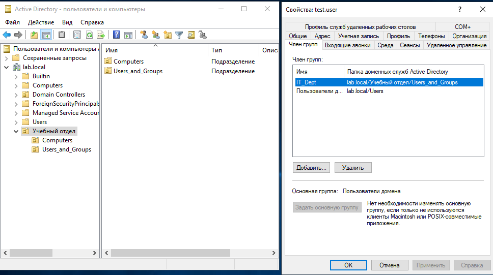
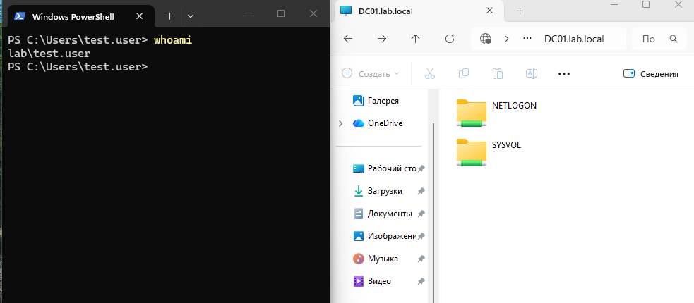

# Lab 02 — Развертывание Active Directory

Практическая работа по развертыванию контроллера домена и управлению объектами AD.

## Что сделано:
*   Установлена роль `AD-Domain-Services` через PowerShell (`Install-WindowsFeature`).
*   Развернут новый лес `lab.local` и поднят DNS-сервер на контроллере домена.
*   **Переименование сервера:** Контроллер домена переименован с автоматически сгенерированного имени на `DC01` для соответствия стандартам инфраструктуры.
*   **Структура OU:** Создано подразделение «Учебный отдел», внутри которого создана иерархия:
    *   `OU=Users_and_Groups` (для пользователей и групп).
    *   `OU=Computers` (для компьютеров).
*   Созданы учетные записи пользователей (`test.user`) и группы безопасности (`IT_Dept`), настроено членство в группах.
*   Выполнено присоединение клиента Windows 11 к домену `lab.local`.
*   Компьютер клиента перенесен в `OU=Computers`, пользователь и группа — в `OU=Users_and_Groups`.

## Проверка (Troubleshooting & Verification):
*   Убедились, что клиент использует DNS контроллера домена (иначе присоединение невозможно).
*   Проверена аутентификация на клиенте через `whoami` (вход под доменной учетной записью `lab\test.user`).
*   Проверен доступ к административным сетевым ресурсам (NETLOGON, SYSVOL) с клиента.

## 📸 Визуализация работы (Скриншоты)

**Структура подразделений (OU) в AD:**

**Клиент Windows 11 успешно присоединен к домену lab.local:**

