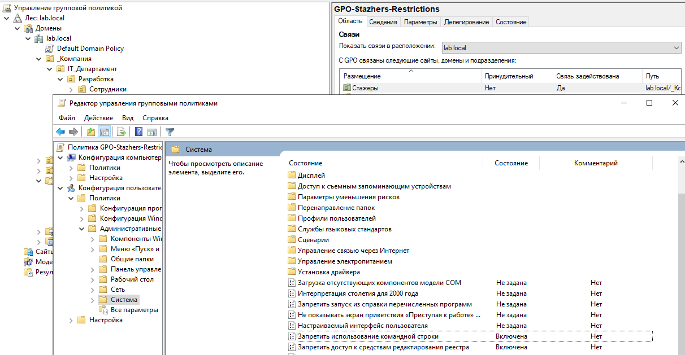
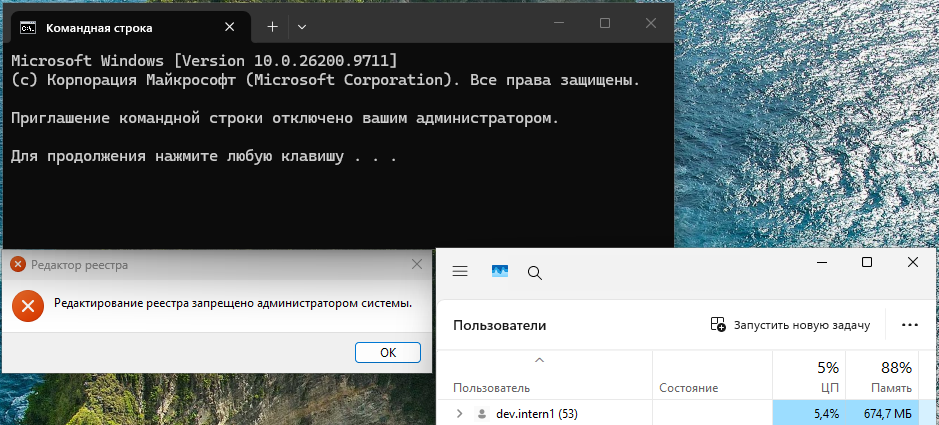

# Lab 03 — Построение структуры в Active Directory и GPO

Практическая работа по созданию иерархии подразделений (OU), настройке групп безопасности по модели AGDLP и применению групповых политик (GPO) в домене `lab.local`.

## Что сделано:
*   **Иерархия OU:** Создана структура `_Компания` -> `IT_Департамент` с разделением на `Разработка` и `Тестирование`. Внутри каждого отдела выделены `Сотрудники` и `Стажеры`. Дополнительно создан OU `Серверы`.
*   **Пользователи:** Созданы учетные записи (dev.user1, dev.user2, dev.intern1, qa.user1, qa.user2, qa.intern1) с требованием смены пароля при первом входе.
*   **Модель AGDLP:**
    *   Созданы глобальные группы (Accounts -> Global): `GG-Dev-Full`, `GG-Dev-Interns`, `GG-QA-Full`, `GG-QA-Interns`.
    *   Создана доменная локальная группа (Domain Local): `DL-Permission-To-Test-Server`.
    *   Пользователи добавлены в глобальные группы, а глобальные группы (Full) добавлены в доменную локальную для выдачи прав.
*   **Автоматизация:** Часть действий выполнена через PowerShell (`New-ADOrganizationalUnit`, `New-ADUser`, `New-ADGroup`, `Add-ADGroupMember`), часть — через графический интерфейс (ADUC).

## 🛡️ Групповые политики (GPO)
1.  **Единая политика паролей:** В `Default Domain Policy` изменен параметр «Минимальная длина пароля» на `10` символов.
2.  **Ограничения для стажеров (`GPO-Stazhers-Restrictions`):** Запрещен доступ к командной строке (`cmd.exe`) и редактору реестра (`regedit.exe`). Политика связана с OU `Стажеры`.
3.  **Аудит безопасности (`GPO-Servers-Audit`):** Включен аудит событий входа в систему (Success/Failure). Политика связана с OU `Серверы`.

## 📸 Визуализация работы

**Настройка GPO на сервере (включены запреты для cmd и regedit):**

**Результат на клиенте Windows 11 (заблокированы и командная строка, и редактор реестра):**

