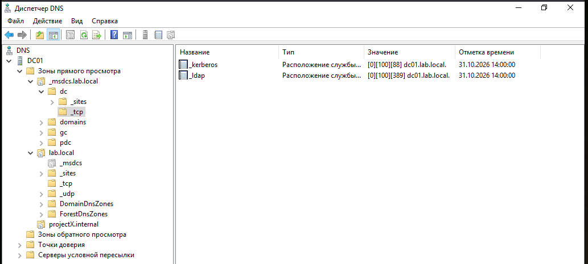
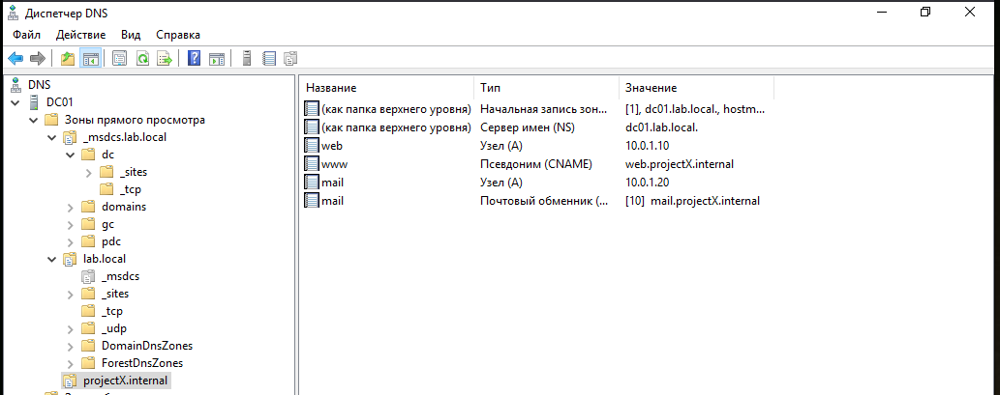
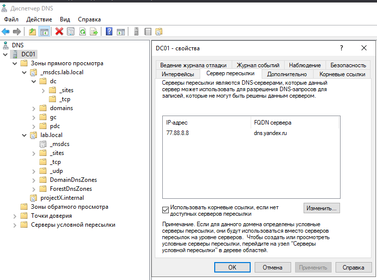
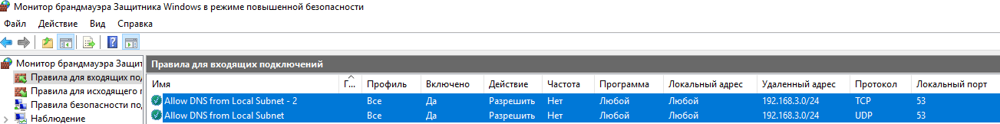

## 🔒 Безопасность и диагностика DNS

В рамках лабораторной работы были применены базовые меры безопасности для DNS-сервера:

1.  **Ограничение трансферов зоны:** Для зоны `projectX.internal` на вкладке **Zone Transfers** установлен запрет на передачу зоны кому-либо (Only to the following servers, список пуст). Это защищает от утечки информации о структуре сети (имен и IP-адресов).
2.  **Настройка форвардеров и рекурсии:**
    *   Настроены **Forwarders** на публичный DNS (`77.88.8.8` Яндекс), чтобы сервер не выполнял рекурсивные запросы самостоятельно.
    *   Проведен эксперимент с отключением рекурсии (`Disable recursion`). Убедились, что сервер становится авторитативным только для своих зон (lab.local, projectX.internal) и не разрешает внешние имена.
3.  **Фильтрация на брандмауэре:**
    *   Созданы входящие правила (`Allow DNS from Local Subnet`) для протоколов TCP и UDP, разрешающие трафик по порту 53 только из внутренней подсети `192.168.3.0/24`. Это предотвращает использование сервера как открытого резолвера.
## 📸 Визуализация работы

**Структура зоны lab.local и A-записи:**

**Зона projectX.internal (A, CNAME, MX записи):**

**Настройка безопасности (Ограничение трансферов и форвардеры):**

**Фильтрация DNS-трафика на брандмауэре:**

