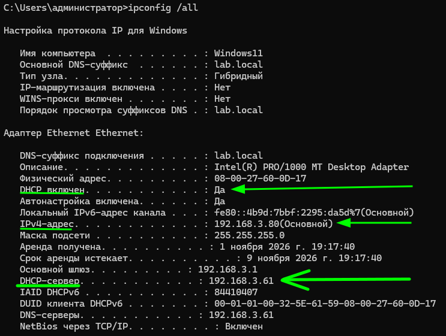
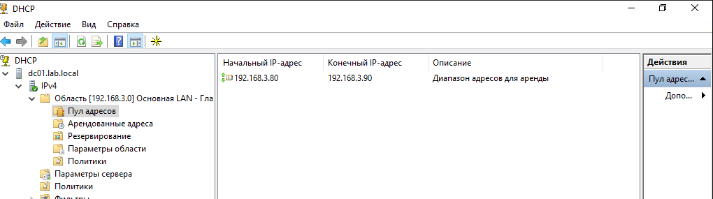
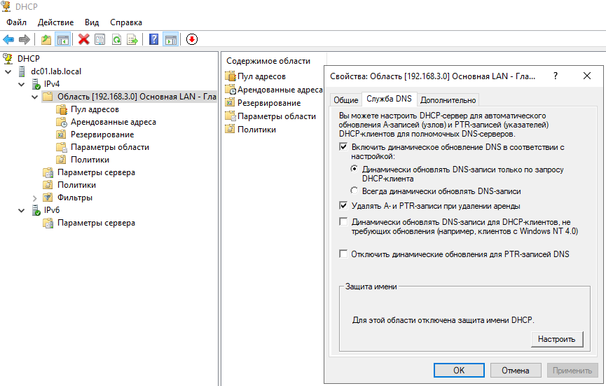
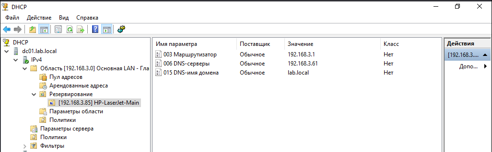
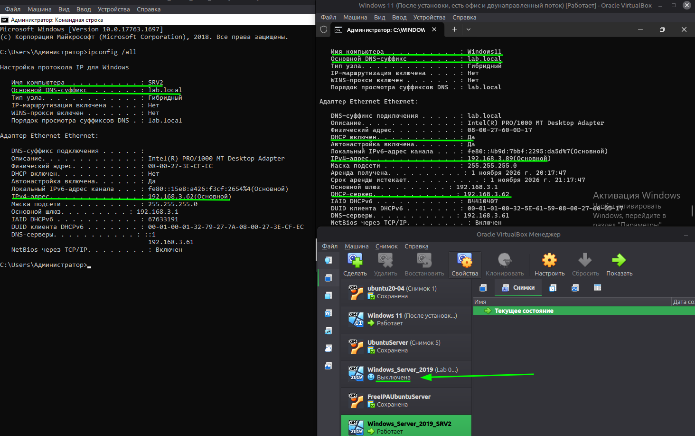
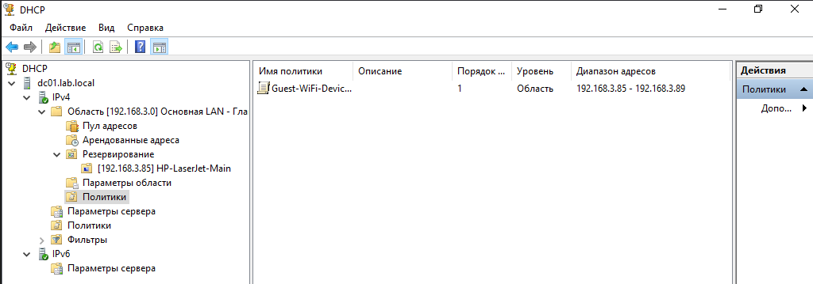
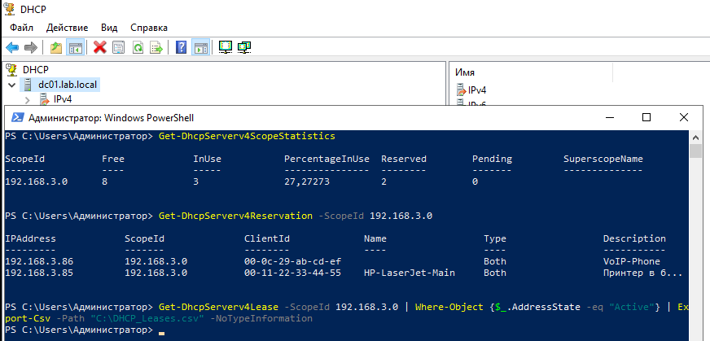

# Lab 05 — Развертывание и настройка DHCP-сервера

Практическая работа по развертыванию DHCP-сервера в домене `lab.local`, настройке интеграции с DNS, резервированию, политикам и обеспечению отказоустойчивости.

## 🛠️ Задание 1. Установка, авторизация и создание области

1.  **Установка роли:** Выполнена команда `Install-WindowsFeature -Name DHCP -IncludeManagementTools`.
2.  **Авторизация в AD:** DHCP-сервер авторизован в Active Directory.
3.  **Создание области (Scope):** Диапазон `192.168.3.80` - `192.168.3.90` (маска `/24`), срок аренды 8 дней.
4.  **Параметры (Options):** Шлюз `192.168.3.1`, DNS `192.168.3.61`, домен `lab.local`.

**Обзор области и пул адресов:**

## 🌐 Задание 2. Интеграция с DNS и резервирование

1.  **Динамическое обновление DNS:** В свойствах области включено безопасное обновление A и PTR записей по запросу клиента.
2.  **Резервирование:** Создано резервирование `HP-LaserJet-Main` (IP `192.168.3.85`, MAC `00-11-22-33-44-55`).

**Настройка DNS и резервирование:**

## 🔄 Задание 3. Настройка отказоустойчивости (DHCP Failover)

*   **Подготовка:** Клонирован второй сервер `SRV2` (IP `192.168.3.62`), авторизован в AD.
*   **Настройка:** На `DC01` запущен мастер Failover, выбран режим «Балансировка нагрузки» (50/50).
*   **Результат:** Конфигурация реплицирована на SRV2. При выключении DC01 клиент успешно получил адрес от SRV2.

**Тест Failover (DC01 выключен, клиент получает IP от SRV2):**

## 🛡️ Задание 4. Создание интеллектуальных политик (DHCP Policies)

*   Создана политика `Guest-WiFi-Devices` для устройств с MAC-адресом `080027600D17`.
*   Для политики выделен отдельный диапазон: `192.168.3.85` - `192.168.3.89`.

**Созданная политика для гостевых устройств:**

## 📊 Задание 5. Мониторинг, диагностика и PowerShell

1.  **Мониторинг:** Получена статистика области, проверен список резервирований, выполнен экспорт активных аренд в CSV.
2.  **Авторизация через PowerShell:** В связи с визуальным багом оснастки, статус сервера проверен командой `Add-DhcpServerInDC`.

**Управление и мониторинг через PowerShell:**

