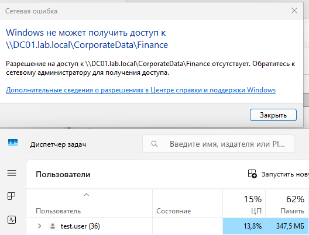
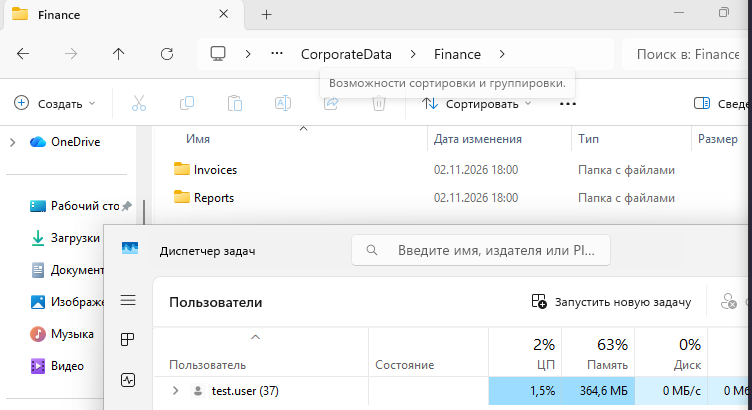
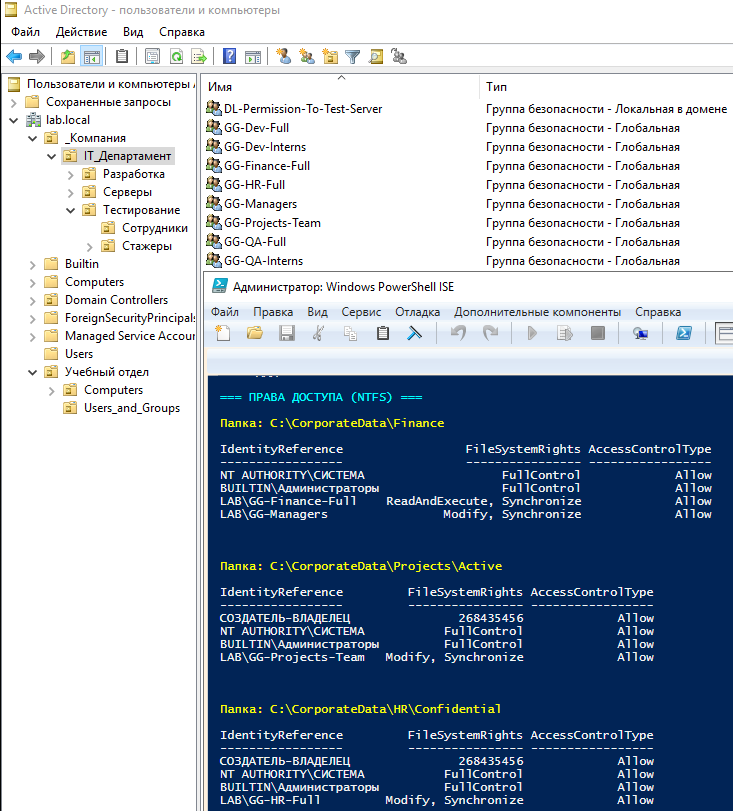
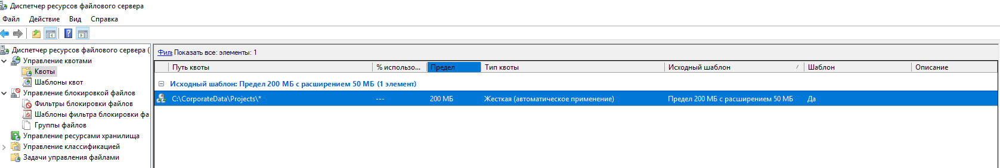
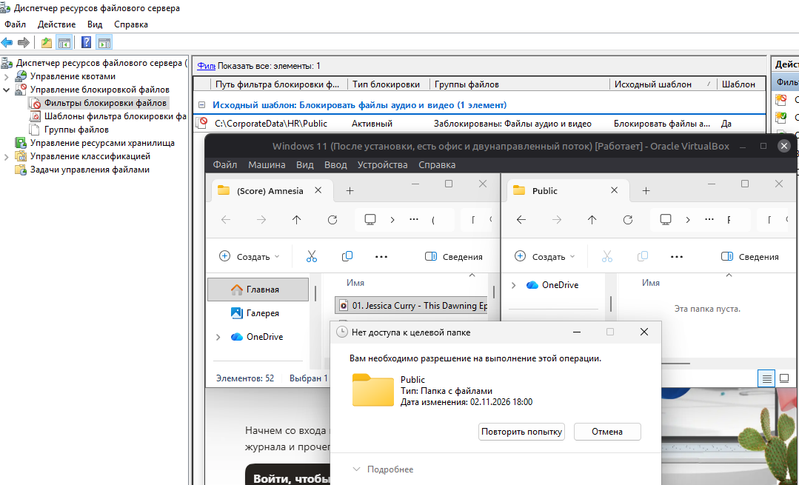

# Lab 06 — Настройка файлового сервера

Практическая работа по развертыванию файлового сервера, созданию структуры каталогов и настройке прав доступа (NTFS + Share).

## 🛠️ Задание 1. Структура и права доступа

1.  **Установка ролей:** Установлены `FS-FileServer` и `FS-Resource-Manager`.
2.  **Структура каталогов:** Создана иерархия в `C:\CorporateData` (Finance, Projects, HR).
3.  **Создание групп:** В AD созданы группы `GG-Finance-Full`, `GG-Projects-Team`, `GG-HR-Full`, `GG-Managers`.
4.  **Настройка NTFS-прав:** Отключено наследование. Для `Finance` доступ получили `GG-Finance-Full` (Modify) и `GG-Managers` (Read). Для `Projects\Active` — `GG-Projects-Team` (Modify). Для `HR\Confidential` — только `GG-HR-Full` (Modify).
5.  **Настройка общего доступа (Sharing):** Папка `CorporateData` опубликована. На уровне Share: `Domain Users` (Read), `GG-Finance-Full` (Change).

## 📉 Задание 2. File Server Resource Manager (FSRM)

1.  **Квоты (Quotas):** Настроена квота на папку `C:\CorporateData\Projects` по шаблону `200 MB Limit with 50 MB Extension` (жесткая квота).
2.  **Экранирование файлов (File Screening):** Настроен файловый экран на папку `C:\CorporateData\HR\Public` по шаблону `Block Audio and Video Files`.

## 📸 Визуализация работы

**Отказ в доступе (пользователь не входит в разрешенную группу):**

**Успешный доступ (пользователь добавлен в группу GG-Finance-Full):**

**Группы в AD и настроенные NTFS-права на каталоги (через PowerShell):**

**Настроенная квота FSRM (200 МБ) на папку Projects:**

**Блокировка аудиофайла на клиенте (сработал File Screen):**

## 🐞 Разобранные проблемы (Troubleshooting)

*   **Ошибка `icacls: Domain Admins not found`:** В русской локали Windows группа администраторов называется `BUILTIN\Администраторы`. Решено заменой имени группы в скрипте и использованием встроенных атрибутов безопасности (SID).
*   **Ошибка «Разрешение на доступ отсутствует» (Access Denied):** При проверке папки `Finance` с клиента под обычным пользователем. Это ожидаемое поведение (демонстрация работы NTFS): пользователь не входит в группу `GG-Finance-Full`.
*   **Сброс наследования прав:** При настройке NTFS-прав через GUI/`icacls` важно было отключить наследование (`Disable inheritance`), иначе права от корневой папки `CorporateData` перезаписывали бы наши ограничения.
